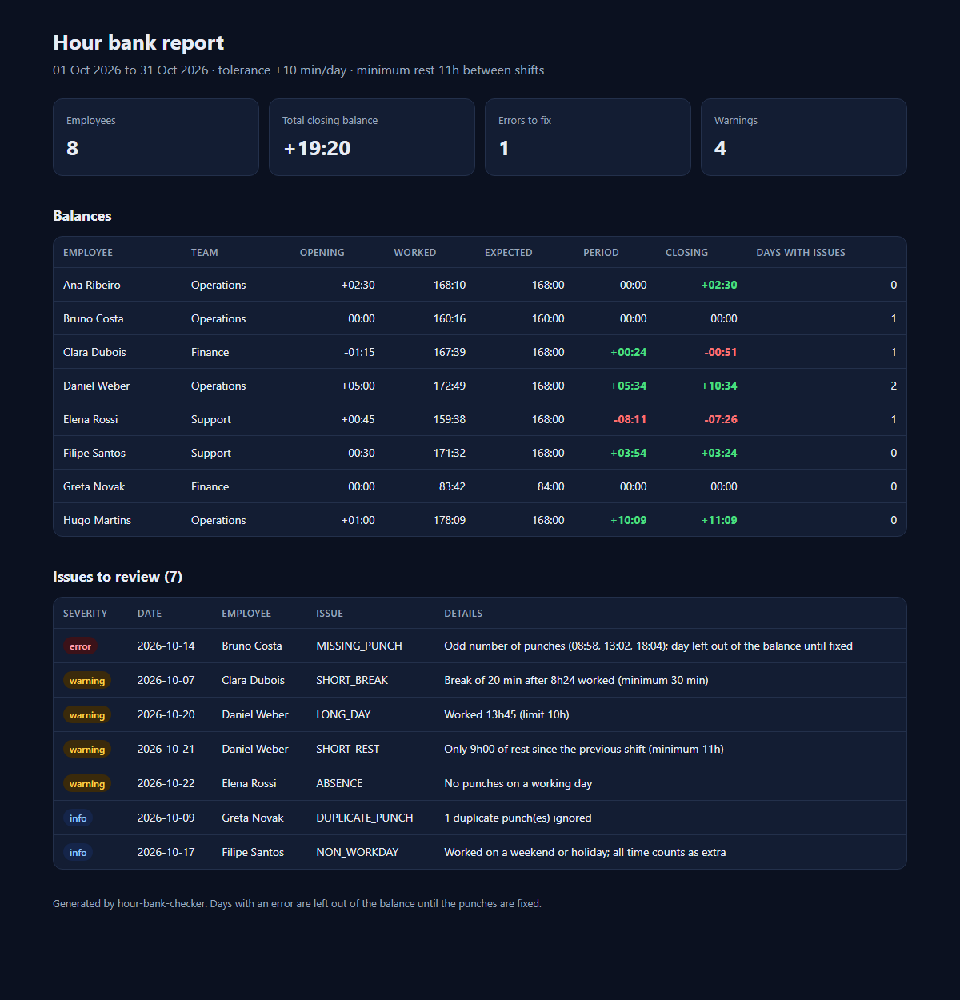

# Hour Bank Checker

[](https://github.com/alelexand/hour-bank-checker/actions/workflows/tests.yml)


Turns a raw time-clock export into **hour bank balances** for every employee and a **list of issues to fix** before payroll: missing punches, short breaks, long days, too little rest between shifts and absences.

HR teams often do this by hand in a spreadsheet every month. This tool does it in a second and produces an Excel file for payroll and an HTML report anyone can open.



> All names and numbers in this repository are fictional and generated by `hour_bank/sample.py`.

## What it checks

| Issue | Severity | Rule (configurable) |
|---|---|---|
| `MISSING_PUNCH` | error | Odd number of punches in a day. The day stays out of the balance until fixed. |
| `ABSENCE` | warning | No punches on a working day. Counts as negative hours. |
| `SHORT_BREAK` | warning | More than 6h worked with less than 30 min of break. |
| `LONG_DAY` | warning | More than 10h worked in a day. |
| `SHORT_REST` | warning | Less than 11h between the end of one shift and the start of the next. |
| `NON_WORKDAY` | info | Work on a weekend or holiday. All of it counts as extra. |
| `DUPLICATE_PUNCH` | info | Two punches within 2 minutes (a double badge tap). The extra one is ignored. |

Daily differences within **±10 minutes** are treated as zero. The defaults follow common European practice (EU Working Time Directive: 11h daily rest, a break after 6h). Every value can be changed in `Rules` to match a country or a collective agreement.

## Quick start

```bash
git clone https://github.com/alelexand/hour-bank-checker.git
cd hour-bank-checker
python -m venv .venv
# Windows: .venv\Scripts\activate   ·   macOS/Linux: source .venv/bin/activate
pip install -r requirements.txt

python -m hour_bank sample --out sample_data        # a month of fictional data
python -m hour_bank report --data sample_data       # builds reports/hour_bank_2026-10.xlsx and .html
```

Console output:

```
  Employee            Opening   Period  Closing  Issues
  Ana Ribeiro          +02:30    00:00   +02:30
  Bruno Costa           00:00    00:00    00:00  1
  Clara Dubois         -01:15   +00:24   -00:51  1
  Daniel Weber         +05:00   +05:34   +10:34  2
  ...
  1 error(s) to fix, 4 warning(s) to review
```

## Using your own data

Export two files from your time-clock system, as **CSV** (comma or semicolon) or **Excel**:

**employees.csv**

| employee_id | name | team | weekly_hours | opening_balance |
|---|---|---|---|---|
| E001 | Ana Ribeiro | Operations | 40 | 02:30 |
| E007 | Greta Novak | Finance | 20 | -00:45 |

`weekly_hours` accepts `40`, `37.5`, `37,5` or `37:30`. `opening_balance` is optional and is the balance carried over from the previous month.

**punches.csv**: one row per badge tap, in any order.

| employee_id | timestamp |
|---|---|
| E001 | 2026-10-01 08:57:00 |
| E001 | 2026-10-01 13:02:00 |

**holidays.csv** (optional): a `date` column.

```bash
python -m hour_bank report --employees employees.xlsx --punches punches.csv --holidays holidays.csv \
                           --start 2026-10-01 --end 2026-10-31 --tolerance 5 --out reports
```

Add `--strict` to exit with code `1` when there are errors, which is useful in a scheduled job that should alert someone.

## Output

- **Excel**, with three sheets: *Summary* (balances per employee), *Issues* (colour-coded by severity) and *Daily* (every employee, every day, with punches and differences). Filters and frozen headers are already set.
- **HTML**: a single self-contained file that works on mobile and in dark mode. It can be emailed or published as is.

## Project structure

```
hour_bank/
├── engine.py         # rules: pairs punches, computes balances, flags issues (no I/O, fully unit-tested)
├── io.py             # reads CSV/Excel and validates columns and values
├── report_excel.py   # Excel report (openpyxl)
├── report_html.py    # HTML report
├── sample.py         # deterministic fictional data with planted issues
└── cli.py            # command line
tests/                # 35 tests (pytest)
```

## Tests

```bash
pip install pytest
pytest
```

## Limitations

- Shifts that cross midnight are not supported yet: each calendar day is evaluated on its own.
- Expected hours are the weekly hours divided evenly across the working days.

## License

MIT. Built by [Alexandre Lasse](https://alelexand.github.io), freelance developer of automation and custom software for SMEs. Need something like this for your company? [Get in touch](https://alelexand.github.io/#contact).
